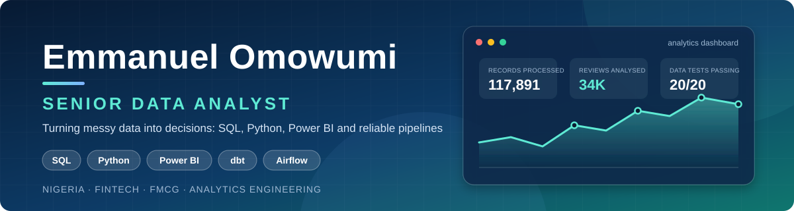

  

Nigeria 🇳🇬 &nbsp;·&nbsp; Open to Data Analyst & Data Engineering roles (on-site, hybrid or remote)

  
  
  
  

---

## About

Data analyst with **3 years of professional experience** in business intelligence, dashboard development and SQL-based reporting. B.Sc. and M.Sc. (Kwara State University). I currently work as a **Data Analyst in the Sales Department at Learn Africa Plc**, and previously worked as a **Senior Data Analyst at Softrays Information Technology**, turning operational data into insights that support finance, marketing and sales decisions.

I am building on that foundation toward **Data Engineering**: reliable pipelines, well-designed data models, tested transformations and clear data storytelling. The projects below were built to show those skills end to end: five business-analytics projects (two on **real public data**: NBS inflation statistics and app reviews; three on synthetic data: **FMCG distribution** and two **Power BI case studies** on retail profitability and HR attrition), alongside five fintech data-engineering projects (payments, wallets and digital lending).

## Featured projects: business analytics on Nigerian data

Built to show analytics for hiring managers in any sector: real data, SQL, BI modelling and clear recommendations.

| Project | What it demonstrates | Stack |
| --- | --- | --- |
| **[Nigeria Cost-of-Living Tracker](https://github.com/Nuelwumi2024/nigeria-cost-of-living-tracker)** | **Real NBS CPI data (1995-2026)**: inflation drivers, purchasing power and the ₦70,000 minimum wage, urban vs rural, and a scenario outlook. Found and flagged a January anomaly in the published index. Includes a Power BI model and an executive brief. | Python, pandas, Power BI (DAX), pytest, GitHub Actions |
| **[FMCG Distribution Analytics](https://github.com/Nuelwumi2024/nigeria-fmcg-distribution-analytics)** | **Commercial analytics in SQL**: margin squeeze, Pareto/ABC, channel mix, silent-outlet detection, stock-out loss and rep attainment, with estimators validated against known ground truth. | SQL, DuckDB, Python, Power BI (DAX), pytest |
| **[Nigerian App Review Analysis](https://github.com/Nuelwumi2024/nigeria-app-review-analysis)** | **Customer-experience analytics** on public Play Store reviews of fintech, bank and telecom apps: complaint themes, rating penalties, a ranked fix list per app. | Python, pandas, NLP (rule-based), pytest |
| **[Atlas Global Retail: Profit Case Study](https://github.com/Nuelwumi2024/powerbi-global-superstore-analysis)** | **Power BI story**: why sales grew 43% while profit grew 6%. Star schema, DAX, budget vs actual; heavy discounts (30%+) lost $105K, and a 20% cap would add about $125K profit. Finished `.pbix` included. | Power BI, DAX, Power Query, Python |
| **[HR Attrition & Workforce Analytics](https://github.com/Nuelwumi2024/powerbi-hr-attrition-dashboard)** | **People analytics in Power BI**: 27.5% attrition (49% in Customer Support), overtime lifting attrition from 23% to 38%, about $13M replacement cost, five costed recommendations. | Power BI, DAX, Power Query, Python |

> The distribution, retail and HR projects use seeded **synthetic** data and say so. The cost-of-living and app-review projects use real public data (NBS statistics, public app reviews).

## Featured projects: fintech data engineering & analytics

Each repo has its own README with architecture, results and run instructions. CI is green on every one.

| Project | What it demonstrates | Stack |
| --- | --- | --- |
| **[Naira Payments ETL Pipeline](https://github.com/Nuelwumi2024/naira-payments-etl-pipeline)** | Batch ETL with a **star schema**, bad-record **quarantine with reasons**, row-count **reconciliation**, quality gates that fail the run, an audit table and an Airflow DAG. | Python, pandas, DuckDB, SQL, pytest, Airflow, GitHub Actions |
| **[Fintech dbt Analytics Warehouse](https://github.com/Nuelwumi2024/fintech-dbt-analytics-warehouse)** | **Analytics engineering**: layered dbt models (staging → marts), 12 data tests including FK integrity, a custom singular test, reusable macros and CI running `dbt build`. | dbt, DuckDB, SQL, Jinja, GitHub Actions |
| **[Transaction Fraud Analysis](https://github.com/Nuelwumi2024/transaction-fraud-analysis)** | **Data storytelling** for risk teams: fraud lift by segment, rule precision/recall trade-offs, review-queue sizing and a ranked recommendation. | SQL, Python, DuckDB, Matplotlib |
| **[Wallet Churn & Retention Story](https://github.com/Nuelwumi2024/wallet-churn-retention-story)** | **Product and growth analytics**: cohort retention heatmap, channel quality, activation analysis (with a correlation-vs-causation caveat) and actions for Growth. | SQL, Python, DuckDB, Matplotlib |
| **[Loan Portfolio Risk Dashboard](https://github.com/Nuelwumi2024/loan-portfolio-risk-dashboard)** | **Credit-risk monitoring**: PAR 30/60/90, NPL proxy, vintage curves and segment delinquency, with unit-tested metric definitions and an HTML dashboard. | Python, pandas, Matplotlib, pytest |

> **Note on data:** all five projects use a seeded, **synthetic** dataset that mimics a Nigerian payments and lending business. No real customer data is used, and each README states this openly.

### What these projects show

- **Pipeline thinking:** extract, validate, model, load, test and monitor, with reconciliation built in.
- **Data quality as a feature:** tests, quarantine tables and failing builds rather than silent bad data.
- **Domain fluency:** fraud lift and precision/recall, retention cohorts, PAR/NPL and vintage analysis.
- **Communication:** findings written for decision-makers, with recommendations and honest caveats.
- **Engineering habits:** version control, unit tests, CI and reproducible runs.

## Technical skills

| Area | Tools & concepts |
| --- | --- |
| Languages | Python, SQL |
| Data engineering | ETL/ELT design, star-schema modelling, dbt, DuckDB, data-quality testing, Airflow (DAG authoring), GitHub Actions CI |
| Databases | MySQL, SQL Server, DuckDB |
| BI & visualisation | Power BI, Tableau, Excel, DAX |
| Data processing | pandas, NumPy, Power Query, data wrangling |
| Analytics | Cohort and retention analysis, statistical analysis, risk and KPI reporting |

## Earlier analytics work

- **Financial Sales Data Analytics** (*Excel, MySQL*): Analysed the financial performance of a global sales company across 2013 and 2014. Built relational tables in MySQL and visualised trends in manufacturing cost, profit margin and customer reviews.
- **Sales Analytics & Operations Dashboard** (*Excel, Power BI*): Converted fragmented sales records into an interactive dashboard tracking performance by region, product and customer segment.
- **Global Store Finance Records** (*Excel, MySQL*): Consolidated high-volume transactional data to assess operational efficiency, regional supply constraints and profit margins across product categories.
- **Chocolate Revenue Pipeline & Dashboard** (*Power Query, Power BI, Excel*): Cleaned data with missing values, built an end-to-end ETL process and identified seasonal demand patterns and top revenue-generating products.

## Experience

**Data Analyst, Sales Department, Learn Africa Plc** *(June 2025 – Present)*
- Turn sales data into reporting and insight that supports sales decisions, using SQL, Power BI and Excel.

**Senior Data Analyst, Softrays Information Technology** *(January 2023 – March 2025)*
- Built and maintained Tableau and Power BI dashboards that tracked KPIs for projects and teams.
- Analysed customer survey data in Excel, R and Python to identify trends that shaped marketing strategy.
- Queried relational databases with SQL and applied hypothesis testing, correlation and regression.

**Quality In-Process Analyst, Olam** *(February 2021 – December 2023)*
- Analysed microbiological and quality test data, led root cause analysis and produced trend reports for management.

## Certifications & training

- Microsoft PL-300: Power BI Data Analyst Associate *(exam preparation)*
- Advanced Data Analytics 2025 (Excel, SQL, Power BI, Python)
- Advanced BI & DAX Modelling (Excel / Power Query)

## Education

- **M.Sc. Microbiology**, Kwara State University (2021 – 2023)
- **B.Sc. Microbiology**, Kwara State University

My scientific research background built a strong foundation in data validation, statistical thinking and structured experimentation, which I apply to analytics work today.

## Let's connect

I am open to **Data Analyst** and **Data Engineering** roles, particularly in **fintech**, and to collaboration on data projects.

- 💼 [LinkedIn](https://www.linkedin.com/in/emmanuel-omowumi-98bb03139/)
- 🌐 [Portfolio website](https://nuelwumi2024.github.io/)
- 📊 [Data Science Portfolio](https://www.datascienceportfol.io/emmanueloluwatobi201)
- 📧 emmanueloluwatobi2015@gmail.com
